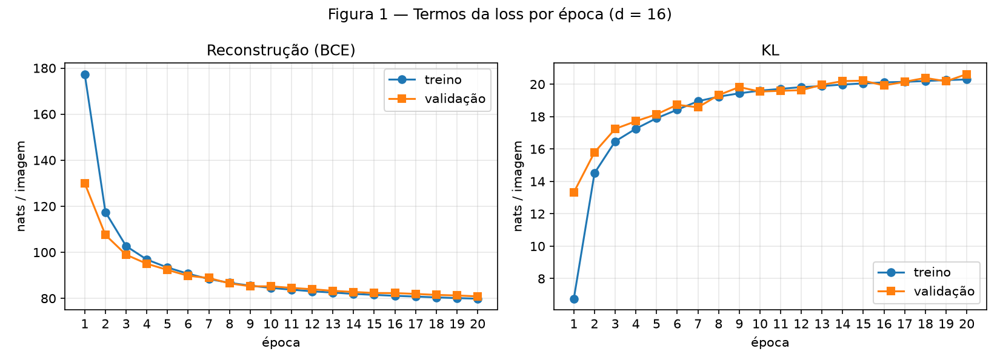
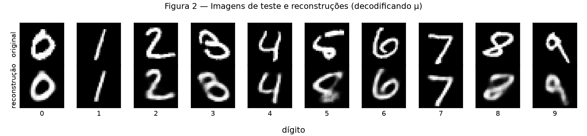
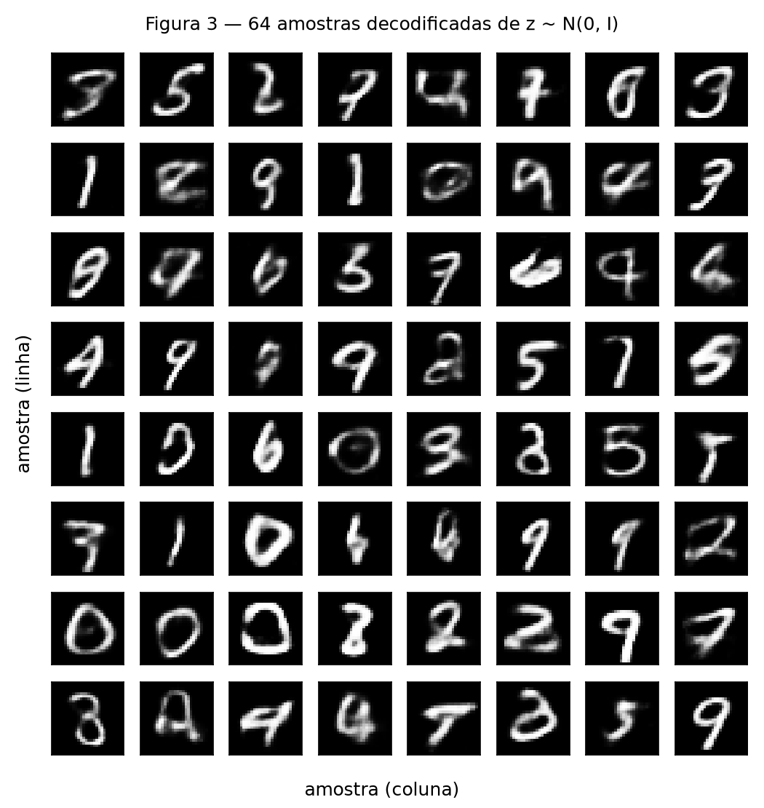
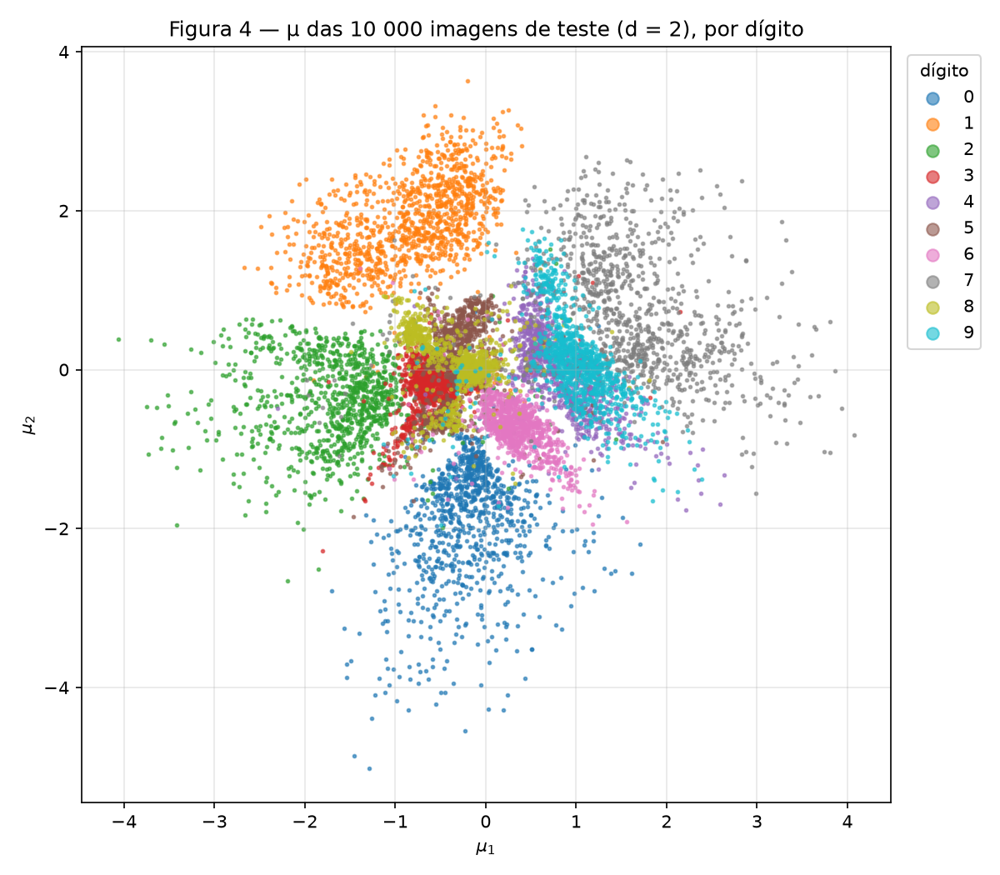
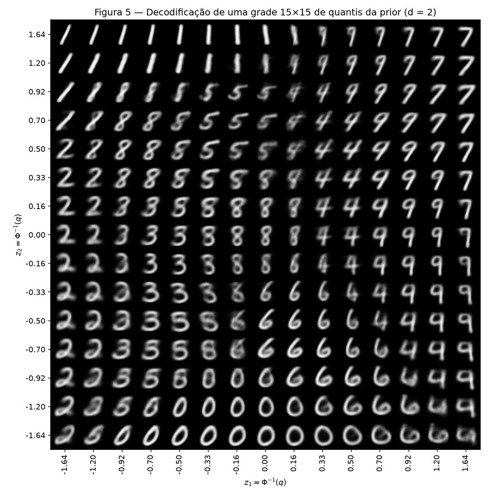
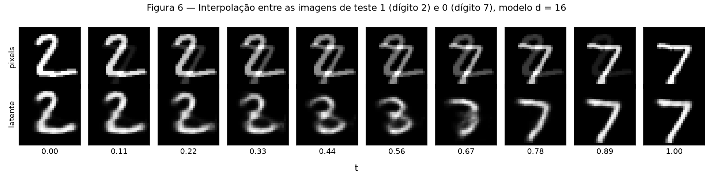

# 4. VAE

!!! abstract "Enunciado"

    [Exercises → VAE](https://insper.github.io/ann-dl/2026.2/exercises/vae/){:target='_blank'} · prazo **01.nov.2026**

!!! note "Reprodutibilidade"

    `torch.manual_seed(42)` imediatamente antes de construir o modelo e
    `torch.Generator().manual_seed(42)` no `random_split`. A Figura 3 usa
    `torch.manual_seed(0)` antes do sorteio, como pede o enunciado. Cada script treina o(s)
    modelo(s), imprime os números citados no texto e gera as suas figuras. A partir da raiz
    do repositório (cerca de 3 minutos por modelo em CPU):

    ```shell
    python docs/exercises/vae/code/exercise1.py   # Figuras 1–3 (d = 16)
    python docs/exercises/vae/code/exercise2.py   # Figuras 4–6 (d = 2 e d = 16)
    ```

    O `exercise2.py` treina de novo o modelo $d = 16$ (necessário para a Figura 6); com as
    mesmas sementes, ele reproduz exatamente os números do Exercício 1.

## Exercise 1

**A VAE on MNIST**

``` { .python .copy .select linenums='1' title="docs/exercises/vae/code/exercise1.py" }
--8<-- "docs/exercises/vae/code/exercise1.py"
```

### A — Carregar e dividir os dados

O MNIST é carregado pelo `torchvision` com `transforms.ToTensor()`, que deixa os pixels em
$[0, 1]$. As 60 000 imagens de treino são divididas em **50 000 de treino** e **10 000 de
validação** com `random_split` e o gerador fixo em 42, exatamente como no enunciado (função
`data`). As 10 000 imagens oficiais de teste formam o conjunto de teste.

Cada imagem sai do `DataLoader` no formato `(B, 1, 28, 28)` e é achatada para um vetor de
784 posições com `x.view(x.size(0), -1)` antes de entrar no modelo.

O conjunto de teste **não participa de nenhuma decisão de treino**: durante as 20 épocas só
o treino e a validação são avaliados, e o teste é medido uma única vez, depois do fim do
treino, para os números finais.

### B — Construir o modelo

| Bloco | Camadas | Ativação |
|---|---|---|
| Encoder | $784 \to 512 \to 256$ | ReLU após cada camada |
| Cabeças | duas lineares $256 \to d$: uma para $\mu$, outra para $\log\sigma^2$ | nenhuma |
| Decoder | $d \to 256 \to 512 \to 784$ | ReLU nas ocultas, sigmoid na saída |

com $d = 16$. A cabeça de variância prevê $\log\sigma^2$ em vez de $\sigma$ porque uma camada
linear pode devolver qualquer número real, e $\sigma$ precisa ser positivo; o $\exp$ garante
isso e deixa o treino numericamente estável.

**Reparametrização.** Sortear $z \sim \mathcal N(\mu, \sigma^2)$ diretamente não é
derivável, então o gradiente não chegaria ao encoder. A aleatoriedade é isolada num ruído
externo:

$$
z = \mu + \sigma \odot \varepsilon, \qquad \varepsilon \sim \mathcal N(0, I), \qquad
\sigma = \exp\left(\tfrac12 \log\sigma^2\right)
$$

No código (`reparameterize`): `std = torch.exp(0.5 * logvar)`,
`eps = torch.randn_like(logvar)` e `z = mu + std * eps`. Como $\varepsilon$ não depende de
nenhum peso, $z$ é uma soma e um produto de $\mu$ e $\sigma$, e o gradiente passa por eles.

**Loss** (função `vae_loss`), por imagem, com $\beta = 1$ e média sobre as imagens do batch:

$$
\mathcal L = \underbrace{-\sum_{j=1}^{784} \left[ x_j \log \hat x_j + (1 - x_j)\log(1 - \hat x_j) \right]}_{\text{reconstrução (BCE)}}
\; + \; \beta \underbrace{\tfrac12 \sum_{i=1}^{d} \left( \mu_i^2 + \sigma_i^2 - 1 - \log\sigma_i^2 \right)}_{\text{KL}}
$$

- **Reconstrução:** `F.binary_cross_entropy(x_hat, x, reduction="sum") / B`. A soma é sobre
  os pixels de todas as imagens do batch, e a divisão por `B` dá "soma por imagem, média entre
  imagens". Com `reduction="mean"` a média também seria feita sobre os 784 pixels, o que
  encolheria a reconstrução 784 vezes em relação à KL.
- **KL:** escrita à mão em forma fechada,
  `0.5 * torch.sum(mu.pow(2) + logvar.exp() - 1 - logvar) / B`, sem
  `torch.distributions`.

A função devolve o total (usado no `backward`) e os dois termos separados, em nats por
imagem. Conferências feitas: com $\mu = 0$ e $\log\sigma^2 = 0$ a KL dá exatamente **0**;
com $\mu = 1$ e $\log\sigma^2 = 0$ dá **8** ($= \tfrac12 \cdot 16$); e o modelo sem treino
tem reconstrução de cerca de **545** nats, próxima de $784 \ln 2 \approx 543$, que é o
valor de um decoder que chuta 0,5 em todos os pixels.

### C — Treinar

Adam com taxa de aprendizado $10^{-3}$, batch de 128 (com `shuffle` só no treino) e 20
épocas. A cada época são registrados reconstrução e KL **separados**: no treino, a média da
época ponderada pelo tamanho de cada batch; na validação, medidos ao fim da época com
`model.eval()` e `torch.no_grad()` (função `avaliar`). O teste é avaliado uma vez, depois do
treino, com a mesma função.

| Conjunto | Reconstrução (nats/imagem) | KL (nats/imagem) | −ELBO (nats/imagem) |
|---|---:|---:|---:|
| **Teste** | **80,18** | **20,70** | **100,88** |

Os valores batem com os esperados pelo enunciado (cerca de 81 de reconstrução e 20 de KL).
Na validação, a KL foi de **13,3** nats na primeira época para **20,6** na última, e a
reconstrução foi de 130,0 para 80,9.


/// caption
**Figura 1** — Reconstrução (esquerda) e KL (direita) por época, em nats por imagem, no
treino e na validação. A reconstrução cai de forma contínua enquanto a KL sobe, rápido nas
primeiras épocas e devagar no fim. Na época 1 a validação fica abaixo do treino porque o
valor de treino é a média da época inteira, incluindo os primeiros batches com o modelo
ainda ruim, enquanto a validação é medida só no fim da época.
///

### D — Reconstruções e amostras


/// caption
**Figura 2** — Linha de cima: a primeira imagem do conjunto de teste de cada dígito, de 0 a
9. Linha de baixo: a reconstrução, obtida decodificando $\mu$ (sem sortear $z$).
///


/// caption
**Figura 3** — 64 imagens decodificadas de $z \sim \mathcal N(0, I)$, sorteados depois de
`torch.manual_seed(0)`.
///

As reconstruções preservam o dígito e o estilo do traço na maioria dos casos, mas são mais
borradas que os originais, e os dígitos de forma mais incomum se confundem (o 3 sai próximo
de um 8 e o 5 fica difuso). As amostras da Figura 3 são em geral reconhecíveis como dígitos,
mas mais borradas que as reconstruções, e algumas são formas misturadas que não correspondem
a dígito nenhum.

### E — Análise

**1. Por que a KL sobe nas primeiras épocas enquanto a loss total cai?**

No início do treino o encoder praticamente não transmite informação: com pesos pequenos,
$\mu \approx 0$ e $\log\sigma^2 \approx 0$, então $q(z \mid x)$ é quase a própria prior e a
KL fica perto de zero. Só que, nesse estado, o código $z$ não diz nada sobre $x$, e o decoder
só consegue produzir uma imagem "média", com reconstrução alta. Para reconstruir melhor, o
encoder precisa colocar informação sobre a imagem em $z$: afastar $\mu$ da origem para
imagens diferentes e encolher $\sigma$ para que o código seja preciso. Isso afasta
$q(z \mid x)$ da prior, e a KL mede justamente esse afastamento, a quantidade de informação
(em nats) que o código carrega sobre a imagem. O otimizador aceita pagar mais KL porque a
troca compensa: entre a primeira e a última época, a KL de validação subiu cerca de 7 nats
enquanto a reconstrução caiu cerca de 49 nats. Cada nat de informação no código economiza
vários nats de reconstrução, então o total cai. Com o tempo o ganho marginal diminui, e as
duas curvas se estabilizam.

**2. Por que a Figura 3 é pior que a Figura 2? Duas razões distintas.**

- **Onde as amostras da prior caem no espaço latente.** Na Figura 2, $\mu$ vem do encoder
  aplicado a uma imagem real, então cai numa região do espaço latente que o decoder viu muito
  durante o treino. Na Figura 3, $z$ vem da prior $\mathcal N(0, I)$, que não coincide com a
  distribuição dos códigos que o encoder realmente produz (a média de todas as
  $q(z \mid x)$). Em 16 dimensões, essa distribuição de códigos não preenche a prior por
  igual: sobram regiões de densidade alta na prior onde quase nenhuma imagem de treino foi
  codificada. Um $z$ sorteado ali cai numa região que o decoder nunca aprendeu, ou entre as
  regiões de dois dígitos, e o resultado é uma mistura que não é dígito nenhum.
- **O que o decoder devolve para um dado $z$.** O decoder não devolve uma imagem amostrada,
  e sim a média de uma Bernoulli por pixel: a probabilidade de cada pixel estar aceso. Um
  mesmo $z$ é compatível com várias imagens um pouco diferentes (traço um pouco mais grosso,
  um pouco mais inclinado), e a perda BCE é minimizada exatamente pela média dessas
  possibilidades. A média de vários traços ligeiramente deslocados é um traço borrado. Para
  um $z$ incerto, como os da prior, essa incerteza é maior e o borrão também; o
  $\mu$ de uma imagem real é um código preciso, então a média fica mais nítida
  ([aula: por que as amostras são borradas](https://insper.github.io/ann-dl/2026.2/classes/variational-autoencoders/#why-the-samples-are-blurry-and-why-it-does-not-matter){:target='_blank'}).

**3. Por que decodificar $\mu$ e não um $z$ sorteado na Figura 2?**

$\mu$ é o centro de $q(z \mid x)$, o código mais provável para aquela imagem. Sortear
$z = \mu + \sigma \varepsilon$ acrescentaria ruído: a reconstrução mudaria a cada execução
e, na média, ficaria pior, porque um $z$ deslocado se aproxima das regiões de outras imagens.
O objetivo da Figura 2 é mostrar o quanto o código representa bem a imagem, e isso se mede
de forma determinística com o código central. O sorteio só é necessário no treino, onde ele
estima a esperança da ELBO e é o que força o decoder a funcionar numa vizinhança de $\mu$, e
não só num ponto.

## Exercise 2

**A Latent Space You Can See**

``` { .python .copy .select linenums='1' title="docs/exercises/vae/code/exercise2.py" }
--8<-- "docs/exercises/vae/code/exercise2.py"
```

O `exercise2.py` repete o modelo, a loss e o treino do Exercício 1, com a única diferença de
que `treino(d)` recebe a dimensão latente. O `main` treina os dois modelos ($d = 16$ e
$d = 2$), avalia ambos no teste e gera as Figuras 4 a 6.

### A — O mesmo modelo com d = 2

Mesmos dados, mesma semente (`torch.manual_seed(42)` antes do modelo), $\beta = 1$, Adam com
$10^{-3}$, batch 128 e 20 épocas; só muda `VAE(d=2)`.

| Modelo | Reconstrução (nats/imagem) | KL (nats/imagem) | −ELBO (nats/imagem) |
|---|---:|---:|---:|
| $d = 16$ | 80,18 | 20,70 | 100,88 |
| $d = 2$ | **133,86** | **6,75** | 140,61 |

Os valores batem com os esperados pelo enunciado (cerca de 135 e 7). Com $d = 2$ a
reconstrução piora em cerca de 54 nats e a KL cai para um terço: dois números carregam muito
menos informação sobre a imagem que dezesseis, então o código custa menos KL, mas o decoder
tem muito menos com que reconstruir.

### B — O espaço latente


/// caption
**Figura 4** — $\mu$ das 10 000 imagens de teste no modelo $d = 2$, uma cor por dígito.
///

Os dígitos ocupam regiões contínuas do plano, todas concentradas num disco de raio cerca de
3 em torno da origem, como a prior $\mathcal N(0, I)$ força. O 0 (embaixo), o 1 (em cima), o 2
(à esquerda) e o 7 (à direita) formam grupos bem separados; no centro, 3, 5 e 8 se sobrepõem
bastante, e à direita o 4 e o 9 praticamente se confundem.

### C — A grade de quantis


/// caption
**Figura 5** — Imagens decodificadas pelo modelo $d = 2$ numa grade $15 \times 15$ com
$z_k = \Phi^{-1}(q)$, $q$ igualmente espaçado em $[0{,}05;\ 0{,}95]$ nas duas coordenadas
($\Phi^{-1}$ = `scipy.stats.norm.ppf`). O eixo vertical cresce para cima, como na Figura 4.
///

Espaçar $q$ igualmente e aplicar $\Phi^{-1}$ faz cada célula da grade conter **a mesma massa
de probabilidade sob a prior**: os valores de $z$ ficam apertados perto da origem, onde a
prior (e, portanto, a maioria dos códigos) se concentra, e espaçados nas bordas, onde há pouca
massa, em vez de gastar metade da grade em regiões quase vazias.

O plano inteiro decodifica para dígitos, e a disposição repete a da Figura 4: 1 em cima, 0
embaixo, 2 à esquerda, 7 e 9 à direita, 3/5/8 no centro. As passagens entre dígitos são
suaves: o 1 se inclina até virar 7 no topo, o 4 se fecha em 9, o 3 vira 5 e depois 8.

### D — Interpolação em pixels e no espaço latente

Imagens interpoladas: índices de teste **1** (um 2) e **0** (um 7), com
$t \in \{0, \tfrac19, \dots, 1\}$.


/// caption
**Figura 6** — Interpolação entre a imagem de teste 1 (dígito 2) e a 0 (dígito 7). Linha de
cima: espaço de pixels, $(1 - t)\,x_a + t\,x_b$. Linha de baixo: espaço latente do modelo
$d = 16$, decodificando $(1 - t)\,\mu_a + t\,\mu_b$.
///

### E — Análise

**Sobreposição dos dígitos (Figuras 4 e 5).** Os dígitos que se sobrepõem são os que têm
formas parecidas em pixels: 4 e 9 diferem só no fechamento do topo, e 3, 5 e 8 compartilham
a metade de baixo arredondada. O VAE posiciona os códigos de forma que imagens parecidas
fiquem próximas, porque a mesma vizinhança de $z$ precisa decodificar todas elas com
reconstrução boa; ele nunca vê os rótulos. Com só duas coordenadas, não há espaço para
separar todos os pares parecidos, e a KL ainda puxa tudo para perto da origem. A Figura 5
mostra a consequência: as fronteiras entre 4 e 9 e entre 3, 5 e 8 são exatamente as regiões
onde a grade produz formas intermediárias ambíguas, e nenhuma região do plano fica vazia,
porque a prior obriga os códigos a cobrirem o disco central.

**O custo de d = 2.** A ELBO piora cerca de 40 nats por imagem (−ELBO de 140,61 contra
100,88). A KL menor (6,75 contra 20,70) mostra que o código de duas dimensões carrega cerca
de um terço da informação; o que se perde é o detalhe dentro de cada dígito (espessura,
inclinação, estilo), e às vezes a própria identidade do dígito nas regiões de sobreposição.
Em troca, o espaço latente pode ser visto inteiro num plano, como nas Figuras 4 e 5, o que é
impossível com $d = 16$.

**As duas interpolações (Figura 6).** Em pixels, a interpolação é só uma mistura de
intensidades: o 2 vai apagando enquanto o 7 acende no mesmo lugar, e nos passos
intermediários aparecem dois dígitos fantasmas sobrepostos, uma imagem que não é dígito
nenhum. O caminho em linha reta no espaço de pixels sai da região das imagens que parecem
dígitos. No espaço latente, o traço **se deforma**: o 2 perde a base, passa por uma forma
parecida com um 3 e se abre num 7, e quase todos os passos são imagens plausíveis de um
dígito; só perto de $t = 0{,}67$ a transição fica borrada. Isso acontece porque o espaço
latente foi treinado para que pontos próximos decodifiquem imagens parecidas, então a linha
reta entre $\mu_a$ e $\mu_b$ passa por regiões que o decoder conhece, e a geometria do
código acompanha a forma do dígito, não a intensidade de cada pixel.

## Results summary

| # | Métrica | Valor |
|---|---------|-------|
| 1 | Ex. 1: teste, reconstrução / KL / −ELBO ($d = 16$) | 80,18 / 20,70 / 100,88 nats/imagem |
| 2 | Ex. 1: KL de validação na primeira / última época | 13,3 / 20,6 nats/imagem |
| 3 | Ex. 2: teste, reconstrução / KL ($d = 2$) | 133,86 / 6,75 nats/imagem |
| 4 | Ex. 2: os dois índices de teste interpolados | 1 (dígito 2) e 0 (dígito 7) |
