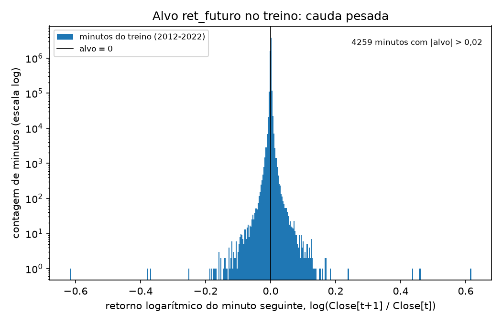
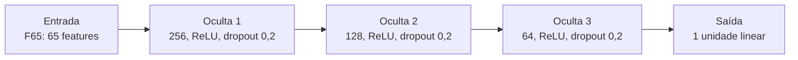
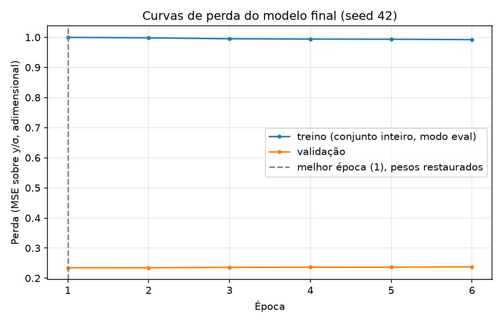
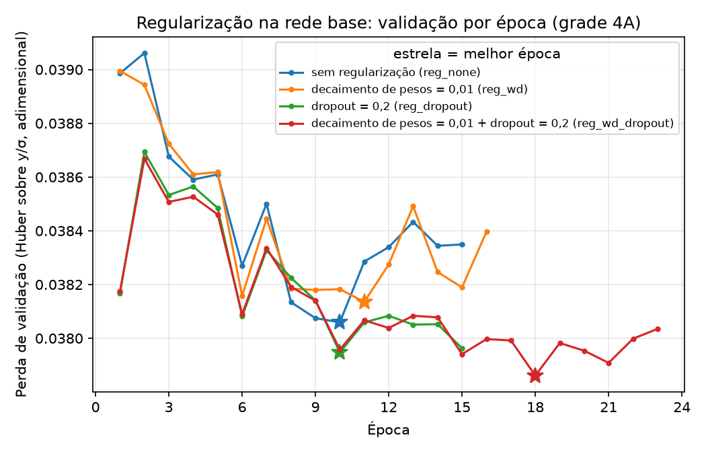
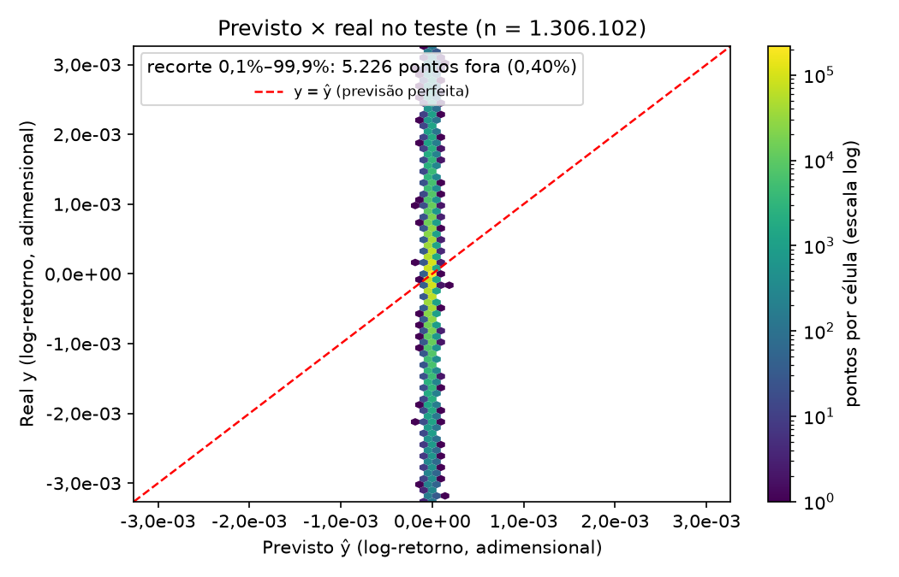
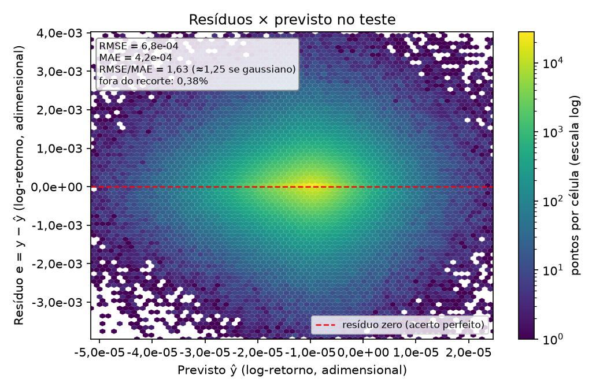
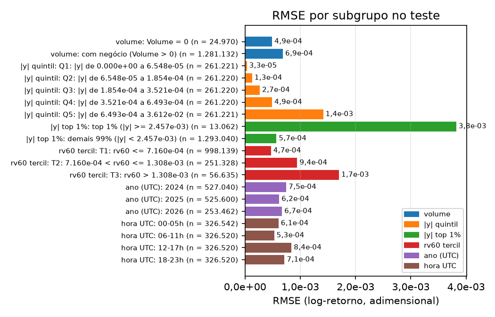
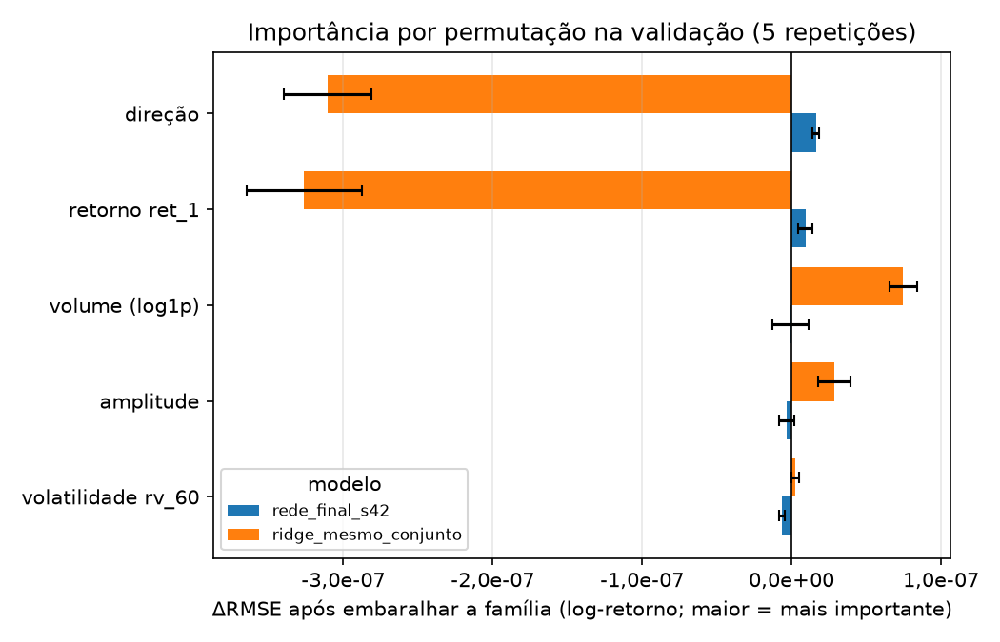

# 2. Regressão

!!! abstract "Entrega 2 de 3 do [Projeto](../index.md)"

    [Projects → Classification or Regression](https://insper.github.io/ann-dl/2026.2/projects/supervised/){:target='_blank'} · prazo **13.nov.2026, 23:59**

!!! info "Equipe"

    | Nome completo | GitHub |
    |---------------|--------|
    | Theo Ribeiro França | TheoRibeiroFranca |
    | Lucas Sato Coelho de Oliveira | lucassatoco |
    | Rafael Kauffmann | RafaelKauffmann |

    Dataset, decisões e status: [página do projeto](../index.md).

Rede neural treinada no mesmo dataset, com a mesma tarefa e o mesmo split do
[EDA](../eda/index.md): prever o **retorno logarítmico do minuto seguinte** do BTC/USD
(`ret_futuro = log(Close[t+1] / Close[t])`) a partir de `ret_1`, `amplitude`, `direcao` e
`log1p(Volume)`. A pergunta que guia a entrega: *a rede aprende algo que modelos simples não
aprendem? E até que ponto dá para confiar no número que ela reporta?*

## 0. Ponto de partida

O pipeline do EDA é importado de [`../eda/code/exercise4.py`](../eda/code/exercise4.py)
(`build_features`, `split`, `make_preprocess`), sem cópia, e ajustado **só no treino**.

| | Treino | Validação | Teste |
|---|--------|-----------|-------|
| Período | 2012-01-01 → 2022-12-31 | 2023-01-01 → 2023-12-31 | 2024-01-01 → 2026-06-26 |
| Linhas | 5 785 917 | 525 599 | 1 306 102 |

A validação sai do **fim do treino, por corte temporal**, como o EDA previu
([EDA §9](../eda/index.md#9-estrategia-de-split)). O teste é usado **uma única vez**, na
seção 5. `SEED = 42` em tudo.

!!! warning "Versão do arquivo"

    O EDA usou a versão do Kaggle que vai até 2026-10-06. Nesta entrega usamos a cópia local do
    mesmo arquivo, que termina em 2026-06-26 00:22 UTC. O corte em 2024-01-01, as regras do split
    e a seed são os mesmos. O conjunto de treino do split tem 6 311 517 linhas, o mesmo número do
    EDA; ao separar a validação, descartamos mais uma linha na borda de 2023-01-01, cujo alvo usa
    o `Close` da validação. Só o fim do teste muda (1 306 102 linhas, contra 1 453 183 no EDA).

!!! note "Correções do EDA"

    Não recebemos comentário da correção do EDA. Revisando o relatório, encontramos estes pontos,
    que corrigimos aqui sem alterar a pasta do EDA:

    1. A tabela da §1 do EDA diz que a tarefa é prever o `Close`, mas o alvo usado é
       `ret_futuro`. Nesta entrega o alvo é sempre `ret_futuro`.
    2. A análise do alvo (1C) foi feita sobre o `Close`. Aqui ela é refeita sobre `ret_futuro`,
       só no treino.
    3. As estatísticas e o Spearman da §1D foram calculados no dataset inteiro, antes do split.
       Aqui toda estatística nova usa só o treino.
    4. O baseline "prever zero" do EDA foi medido no teste. Aqui os baselines são avaliados na
       validação, e o teste só aparece na seção 5.

!!! abstract "Métrica principal e critério de sucesso (definidos antes de treinar)"

    - **Métrica principal: RMSE**, na escala original do log-retorno. MAE e $R^2$ aparecem ao
      lado. Escolhemos o RMSE porque a mediana do alvo no treino é 0 e boa parte dos minutos não
      tem variação: o MAE favorece prever zero, enquanto o RMSE mede o erro em torno da média
      condicional, que é o que uma rede treinada com perda quadrática ou Huber tenta estimar
      (Aula 8.2).
    - **Critério de sucesso:** a rede atinge o critério se as duas condições valerem:
        1. o RMSE de teste da rede (média de 3 seeds) é **pelo menos 0,5% menor** que o RMSE de
           teste do melhor baseline, escolhido na validação;
        2. essa diferença é **maior que 2 desvios-padrão** do RMSE entre as seeds.
    - O exemplo do enunciado (15% de melhora) não é realista para o retorno de um minuto: no EDA
      a correlação mais forte entre uma feature e o alvo foi de −0,11 (Spearman). Um ganho de
      0,5% no RMSE equivale a explicar cerca de 1 ponto percentual a mais da variância do alvo
      ($1 - 0{,}995^2 \approx 0{,}01$).

### O alvo no treino

A correção 2 pede a análise do alvo real. A Figura 1 e a tabela abaixo descrevem `ret_futuro` no
treino (2012–2022) e, só para comparar o regime, na validação (2023). Os números estão em
[`results/target_stats.json`](results/target_stats.json).


/// caption
**Figura 1.** Histograma de `ret_futuro` no treino (5 785 917 minutos), com contagem em escala log.
///

| | Treino (2012–2022) | Validação (2023) |
|---|---|---|
| Desvio-padrão | 1,98e-3 | 5,80e-4 |
| Assimetria | 3,56 | 0,09 |
| Curtose em excesso | 5 697 | 74,7 |
| Maior \|alvo\| | 0,617 | 0,027 |
| Mediana de \|alvo\| | 2,41e-4 | 1,91e-4 |
| Minutos com alvo = 0 | 30,34% | 13,18% |
| Spearman `ret_1` × alvo | −0,120 | −0,003 |
| Pearson `ret_1` × alvo | −0,158 | +0,011 |

Duas leituras orientam o resto da entrega:

- **A cauda é muito pesada no treino.** Com curtose em excesso de 5 697, poucos minutos de 2012 a
  2014 dominariam uma perda quadrática. Por isso a perda inicial foi a Huber (Aula 8.2), e o alvo
  foi padronizado pelo desvio do treino antes de entrar na perda (Aula 2, *Scaling the target*).
- **A correlação que o EDA encontrou não existe em 2023.** No EDA, o Spearman de −0,11 foi
  calculado no treino inteiro, que inclui 2023. Separando os períodos, ele vale −0,120 em
  2012–2022 e −0,003 em 2023. A fração de minutos sem negócio também cai: 94,9% em 2012, 3,8% em
  2018 e 3,9% em 2023 (contagem no arquivo inteiro). O mercado de 2012–2016 não é o mesmo da
  validação e do teste. Por isso testamos a **janela de treino** como hiperparâmetro na seção 4:
  treino completo (2012–2022) ou só 2018–2022.

### Features

Testamos dois conjuntos de entrada, sempre ajustados só no treino:

- **F4:** as 4 features do EDA, com o pipeline do EDA (`StandardScaler` e `log1p` no volume).
- **F65:** as mesmas 4 features nos minutos t, t−1, …, t−15 (64 colunas), mais `rv_60`, o
  desvio-padrão de `ret_1` nos 60 minutos até t. Todas as janelas olham só para trás (Aula 2, Data
  Leakage §3). A Aula 2 usa o mesmo desenho no Lab Step 3 de Data Leakage: lags de uma série de
  retornos como entrada de uma MLP.

Para F4 e F65 usarem as mesmas linhas, descartamos os primeiros 59 minutos de 2012, em que a
janela de 60 minutos ainda não está completa. O treino completo fica com 5 785 858 linhas e a
janela 2018–2022 com 2 629 439. Validação e teste não mudam. Conferimos o vazamento de duas
formas: recalculamos à mão 7 linhas a partir do CSV e trocamos os preços de t+1 em diante em 3
posições do arquivo. As 65 features ficaram idênticas e só o alvo mudou.

## 1. Baselines

Os baselines foram avaliados na **validação** com as mesmas linhas e o mesmo pipeline da rede
([`baselines.py`](code/baselines.py)):

- `DummyRegressor` com a média e com a mediana do treino. A mediana do treino é 0, então ela
  equivale a prever zero.
- **Persistência:** prever que o próximo retorno repete o atual (ŷ = `ret_1`). É o "último valor
  observado" que a Aula 8.2 recomenda para séries temporais.
- **`Ridge`**, com `alpha` em {0,1; 1; 10; 100} escolhido na validação.

| Modelo (validação, 525 599 linhas) | RMSE | MAE | $R^2$ |
|---|---|---|---|
| `DummyRegressor(strategy="mean")` | **5,8036e-4** | 3,3074e-4 | −0,0000004 |
| `DummyRegressor(strategy="median")` (= prever 0) | 5,8036e-4 | 3,3056e-4 | −0,00001 |
| `Ridge`, F4, treino 2018–2022 | 5,8147e-4 | 3,3216e-4 | −0,0038 |
| `Ridge`, F65, treino 2018–2022 | 5,8162e-4 | 3,3197e-4 | −0,0044 |
| `Ridge`, F4, treino 2012–2022 | 5,9182e-4 | 3,3862e-4 | −0,0399 |
| `Ridge`, F65, treino 2012–2022 | 5,9265e-4 | 3,3825e-4 | −0,0428 |
| Persistência | 8,1641e-4 | 4,8400e-4 | −0,9789 |

Tabela completa, com os quatro valores de `alpha` em cada combinação:
[`results/baselines_val.csv`](results/baselines_val.csv).

**Leitura.**

- **Nenhum modelo bate prever a média.** O melhor baseline é o `DummyRegressor(strategy="mean")`,
  com RMSE de 5,8036e-4. É contra ele que o critério da seção 0 compara a rede
  ([`results/baselines_best.json`](results/baselines_best.json)).
- **O `Ridge` treinado em 2012–2022 fica 2,0% pior que a média.** Ele aprende a reversão de
  `ret_1` (Spearman −0,120 no treino), que em 2023 não existe. Treinado só em 2018–2022, ele fica
  0,19% pior. A janela curta ajuda, mas não basta para bater a média.
- **O `alpha` não muda nada:** com milhões de linhas, as quatro opções diferem só na 7ª casa do
  $R^2$.
- **A persistência é a pior**, com $R^2$ de −0,98. Repetir o retorno atual dobra o erro
  quadrático, porque os dois retornos são quase independentes.

## 2. A rede

MLP em PyTorch ([`model.py`](code/model.py)), treinada por [`train.py`](code/train.py). A
arquitetura da tabela é a **escolhida pela validação** na seção 4. A rede base, usada em 4A, tem
duas camadas ocultas de 128 e 64 unidades.



| | Escolha | Por quê |
|---|---------|---------|
| Camadas × unidades | 3 ocultas: 256, 128, 64 (escolhida na busca; a base tinha 128 e 64) | A profundidade aposta em interações entre volatilidade e direção (Aula 9). Na busca, a rede de 3 camadas teve o menor RMSE de validação com Huber (seção 4) |
| Ativação | ReLU | A derivada vale 1 onde a unidade está ativa, sem o gradiente que some da sigmoide (Aula 5). O alvo não tem faixa limitada |
| Inicialização | He (`kaiming_normal_`, fan_in), vieses em zero | É a inicialização para ReLU, com variância 2/n (Aula 9). O padrão do `nn.Linear` usa um sexto dessa variância |
| Saída | 1 unidade linear | O alvo é um número real, positivo ou negativo |
| Perda | MSE sobre $y/\sigma_{tr}$ (escolhida na busca; a inicial era Huber com δ = 1) | A MSE estima a média condicional, que é o que o RMSE mede (Aula 8.2). A Huber protegia da cauda do treino, mas na busca a MSE deu RMSE de validação 0,46% menor (seção 4). O alvo é dividido pelo desvio do treino porque, sem isso, a perda fica na ordem de 1e-6 (Aula 2) |
| Regularização | Dropout 0,2 e weight decay 0,01 | Escolhidos em 4A |
| Nº de parâmetros × linhas de treino | 58 113 parâmetros e 2 629 439 linhas (janela 2018–2022): cerca de 45 linhas por parâmetro. Na rede base, 16 769 parâmetros e 5 785 858 linhas, cerca de 345 por parâmetro | Há muito mais linhas que parâmetros. O risco aqui não é decorar o treino, e sim aprender um padrão do treino que não vale na validação |

??? example "Código da rede: `model.py`"

    ``` python
    --8<-- "docs/projects/regression/code/model.py"
    ```

## 3. Treinamento

| | Escolha | Por quê |
|---|---------|---------|
| Otimizador | AdamW (β₁ = 0,9, β₂ = 0,999) | A Aula 6 indica Adam com lr 1e-3 como padrão para MLP em dados tabulares. O AdamW separa o weight decay da perda; o decay entra só nos pesos, sem os vieses (Aulas 6 e 7) |
| Learning rate | 1e-3 (3e-4 e 3e-3 testados em 4B) | Padrão da Aula 6. Na busca, 1e-3 foi melhor que os dois vizinhos em escala log |
| Batch size | 4 096 | Com milhões de linhas, um batch maior reduz o ruído do gradiente (σ/√B, Aula 6) e deixa a época em poucos segundos na CPU |
| Épocas (máx.) / paciência | 30 / 5 | Early stopping pela perda de validação, restaurando o melhor `state_dict`, como no esqueleto do enunciado (Aula 7) |

A perda de treino e a de validação são medidas no **conjunto inteiro** ao fim de cada época, em
modo `eval` (Handout de Otimização §5.1).


/// caption
**Figura 2.** Perda por época da rede escolhida (seed 42), em unidades de $y/\sigma_{tr}$.
///

**Leitura da Figura 2.**

- **A melhor época é a 1.** A perda de validação sobe de 0,2344 na época 1 para 0,2377 na época
  6, e o early stopping para na 6 e restaura os pesos da época 1. A perda de treino cai de 0,9999
  para 0,9924. Pela tabela da Aula 7, validação parada ou subindo enquanto o treino cai é
  *overfitting*: a rede aprende algo de 2018–2022 que não vale em 2023.
- **A validação fica abaixo do treino, e isso não é vazamento.** A tabela da Aula 7 cita dois
  motivos para a validação ficar melhor que o treino: dropout ligado na avaliação ou vazamento.
  Aqui não é nenhum dos dois:
  - a perda de treino também é medida em modo `eval`;
  - a perda está em unidades de $\sigma_{tr}$, e 2023 tem variância bem menor que 2018–2022
    (desvio de 5,80e-4 contra 1,98e-3 no treino completo). Prever a média dá a mesma diferença.
- **A perda de treino perto de 1** quer dizer que a rede explica menos de 1% da variância do
  próprio treino.

O run levou 206 s com 8 threads. As 16 configurações da busca levaram de 51 s a 652 s cada.

??? example "Código do treino: `train.py`"

    ``` python
    --8<-- "docs/projects/regression/code/train.py"
    ```

## 4. Regularização e hiperparâmetros

### A. Técnicas de regularização

Rede base: F65, treino 2012–2022, camadas de 128 e 64, Huber, lr 1e-3. Ligamos uma técnica de
cada vez, como a Aula 7 recomenda ([`results/grid_4a.csv`](results/grid_4a.csv)).

| Configuração | Val. RMSE | Val. MAE | Melhor época / parada |
|--------------|-----------|----------|-----------------------|
| Sem regularização | 5,8680e-4 | 3,3741e-4 | 10 / 15 |
| Weight decay 0,01 (AdamW) | 5,8788e-4 | 3,3737e-4 | 11 / 16 |
| Dropout 0,2 | 5,8597e-4 | 3,3629e-4 | 10 / 15 |
| **Weight decay 0,01 + dropout 0,2** | **5,8553e-4** | **3,3523e-4** | 18 / 23 |


/// caption
**Figura 3.** Perda de validação por época das quatro configurações de 4A. A estrela marca a
melhor época de cada uma.
///

**Leitura.**

- **O dropout ajuda; o weight decay sozinho não.** O dropout reduz o RMSE de validação em 0,14%.
  O weight decay sozinho piora 0,18%. Juntos, os dois dão o menor RMSE, 0,22% abaixo da rede sem
  regularização.
- **Na Figura 3, as curvas com dropout continuam descendo por mais épocas.** Sem dropout, a
  validação volta a subir depois da época 10.
- **Nenhuma das quatro chega à média** (5,8036e-4): todas ficam entre 0,9% e 1,3% acima dela.
- **A regularização ataca a variância**, e o problema aqui é outro: o padrão do treino não vale
  na validação (Aula 7, "Check yourself").

### B. Busca de hiperparâmetros

Doze configurações, todas com a regularização vencedora de 4A
([`search.py`](code/search.py), [`results/grid_4b.csv`](results/grid_4b.csv)):

- **g01–g08:** F4 ou F65 × treino 2012–2022 ou 2018–2022 × camadas [64, 32] ou [256, 128].
- **g09–g10:** a melhor de g01–g08 com lr 3e-4 e 3e-3.
- **g11:** a melhor até ali com 3 camadas.
- **g12:** a melhor até ali com MSE no lugar da Huber.

Tabela em ordem crescente de RMSE de validação:

| # | Config | Features | Treino | Camadas | lr | Perda | Parâmetros | Melhor época | Val. RMSE | Val. $R^2$ |
|---|---|---|---|---|---|---|---|---|---|---|
| 1 | g12 | F65 | 2018–2022 | 256-128-64 | 1e-3 | MSE | 58 113 | 1 | **5,8061e-4** | −0,0009 |
| 2 | g11 | F65 | 2018–2022 | 256-128-64 | 1e-3 | Huber | 58 113 | 1 | 5,8332e-4 | −0,0103 |
| 3 | g08 | F65 | 2018–2022 | 256-128 | 1e-3 | Huber | 49 921 | 17 | 5,8347e-4 | −0,0108 |
| 4 | g03 | F4 | 2018–2022 | 64-32 | 1e-3 | Huber | 2 433 | 8 | 5,8348e-4 | −0,0108 |
| 5 | g09 | F65 | 2018–2022 | 256-128 | 3e-4 | Huber | 49 921 | 1 | 5,8360e-4 | −0,0112 |
| 6 | g07 | F65 | 2018–2022 | 64-32 | 1e-3 | Huber | 6 337 | 1 | 5,8382e-4 | −0,0120 |
| 7 | g04 | F4 | 2018–2022 | 256-128 | 1e-3 | Huber | 34 305 | 3 | 5,8390e-4 | −0,0122 |
| 8 | g10 | F65 | 2018–2022 | 256-128 | 3e-3 | Huber | 49 921 | 3 | 5,8467e-4 | −0,0149 |
| 9 | g01 | F4 | 2012–2022 | 64-32 | 1e-3 | Huber | 2 433 | 6 | 5,8558e-4 | −0,0181 |
| 10 | g05 | F65 | 2012–2022 | 64-32 | 1e-3 | Huber | 6 337 | 18 | 5,8562e-4 | −0,0182 |
| 11 | g02 | F4 | 2012–2022 | 256-128 | 1e-3 | Huber | 34 305 | 6 | 5,8589e-4 | −0,0191 |
| 12 | g06 | F65 | 2012–2022 | 256-128 | 1e-3 | Huber | 49 921 | 1 | 5,8882e-4 | −0,0294 |

**Leitura.**

- **A janela de treino é o hiperparâmetro que mais pesa.** As 8 melhores configurações treinam
  em 2018–2022, e as 4 piores em 2012–2022.
- **Features e largura quase não mudam o resultado.** Com 2018–2022, a rede F4 de 2 433
  parâmetros (g03) e a F65 de 49 921 (g08) diferem em 0,002%.
- **Em 5 das 12 configurações, a melhor época é a 1.** A rede aprende o pouco que dá na primeira
  passada pelo treino e, depois disso, a validação só piora.
- **A MSE (g12) é melhor que a Huber (g11) em 0,46%.** Nossa hipótese: a Huber com δ = 1 trata como "linear" os
  minutos de cauda e puxa a previsão para algo entre a média e a mediana, enquanto o RMSE premia a
  média condicional (Aula 8.2).

Escolhemos a **g12** pelo menor RMSE de validação, entre as **16 configurações tentadas** (4 em 4A
e 12 em 4B). A Aula 2 (Splitting §4) alerta que o melhor de k candidatos é otimista na validação.
Mesmo assim, a escolhida fica **0,04% acima** de prever a média na validação (5,8061e-4 contra
5,8036e-4). O critério da seção 0 já era difícil antes do teste.

## 5. Avaliação no teste

A g12 foi retreinada com as seeds 42, 43 e 44 ([`final.py`](code/final.py)), com o mesmo treino
e o mesmo early stopping pela validação. As três pararam na época 6 com a melhor época em 1, e o
RMSE de validação variou de 5,8058e-4 a 5,8083e-4.

O teste foi aberto **uma única vez** por [`evaluate_test.py`](code/evaluate_test.py), em
2026-11-12 às 23:50 ([`results/test_opened.json`](results/test_opened.json)). Antes de ler o
teste, o script grava esse marcador e recusa rodar de novo se ele existir. Antes da rodada real,
testamos o script com `--dry-run-val` na validação. **O teste não ajudou a escolher nada:**
arquitetura, janela, perda e baseline de referência vieram da validação.

| Modelo (teste, 1 306 102 linhas) | RMSE | MAE | $R^2$ |
|--------|-----|------|-------|
| `DummyRegressor(strategy="mean")`, o melhor baseline na validação | **6,8208e-4** | 4,1888e-4 | −0,000003 |
| Prever 0 | 6,8208e-4 | 4,1880e-4 | −0,0000002 |
| `Ridge` (F65, 2018–2022) | 6,8298e-4 | 4,2003e-4 | −0,0026 |
| Persistência | 9,6735e-4 | 6,0575e-4 | −1,0114 |
| MLP, seed 42 | 6,8225e-4 | 4,1999e-4 | −0,0005 |
| MLP, seed 43 | 6,8215e-4 | 4,1961e-4 | −0,0002 |
| MLP, seed 44 | 6,8241e-4 | 4,1956e-4 | −0,0010 |
| **MLP, média ± desvio (3 seeds)** | **6,8227e-4 ± 1,3e-7** | 4,1972e-4 ± 2,4e-7 | −0,0005 ± 0,0004 |

Números em [`results/test_table.csv`](results/test_table.csv) e
[`results/test_metrics.json`](results/test_metrics.json).

**Critério da seção 0: não atingido.**

1. O RMSE da rede precisava ficar em 0,995 × 6,8208e-4 = 6,7867e-4 ou menos. Ficou em 6,8227e-4,
   0,03% **acima** do baseline.
2. A diferença para o baseline é de −1,9e-7, e o limite de 2 desvios entre seeds é 2,6e-7. A
   diferença tem o sinal errado e cabe na variação entre seeds: a rede **empata** com prever a
   média.


/// caption
**Figura 4.** Previsto × real no teste (média das 3 seeds), com eixos recortados entre os quantis
0,1% e 99,9%.
///


/// caption
**Figura 5.** Resíduo × previsto no teste. O eixo x é cerca de 100 vezes mais estreito que o eixo y.
///

**Leitura.**

- **A rede prevê quase uma constante.** Na Figura 4, as previsões ocupam uma faixa estreita em
  torno de zero, enquanto o real vai de −3e-3 a 3e-3. A Figura 5 mostra o mesmo: quase todas as
  previsões ficam entre −5e-5 e 2e-5, e o resíduo é praticamente o próprio alvo.
- **A cauda continua pesada no teste.** A razão RMSE/MAE é 1,63, acima de 1,25, que é o valor
  esperado para erro gaussiano (Aula 8.2).
- **A rede reproduz o resultado da validação.** Lá, ela ficou 0,04% acima da média; no teste,
  0,03%.

## 6. Análise de erro

As análises usam as previsões de teste já gravadas ([`error_analysis.py`](code/error_analysis.py)).
Nenhuma decisão de modelo foi tomada a partir delas.

O critério da seção 5 usa a média dos RMSE das 3 seeds (6,8227e-4). Esta seção e as Figuras 4 e 5
usam outra coisa: a média das **previsões** das 3 seeds, cujo RMSE é 6,8221e-4. A diferença
entre as duas formas é de 6e-8.

### A. Erro por subgrupo

Os subgrupos vêm do tempo, do volume, da volatilidade e de faixas do alvo, porque o dataset não
tem categóricas ([`results/subgroups_test.csv`](results/subgroups_test.csv)). Os limites dos tercis
de `rv_60` foram calculados no treino, por isso o teste, que é mais calmo, cai quase todo no tercil 1.
As faixas de \|alvo\| (quintis e top 1%) usam os limites do próprio teste.

| Subgrupo | n | MAE | RMSE | Hipótese |
|----------|---|-----|------|----------|
| `Volume = 0` no minuto t | 24 970 | 2,98e-4 | 4,90e-4 | Minuto sem negócio: o preço está preenchido e o mercado está parado |
| Com negócio | 1 281 132 | 4,22e-4 | 6,85e-4 | |
| \|alvo\| quintil 1 (0 a 6,55e-5) | 261 221 | 2,60e-5 | 3,29e-5 | A rede prevê quase uma constante perto de zero, então o erro acompanha o tamanho do movimento em cada faixa |
| \|alvo\| quintil 2 (6,55e-5 a 1,85e-4) | 261 220 | 1,23e-4 | 1,28e-4 | |
| \|alvo\| quintil 3 (1,85e-4 a 3,52e-4) | 261 220 | 2,63e-4 | 2,68e-4 | |
| \|alvo\| quintil 4 (3,52e-4 a 6,49e-4) | 261 220 | 4,81e-4 | 4,89e-4 | |
| \|alvo\| quintil 5 (6,49e-4 a 3,61e-2) | 261 221 | 1,20e-3 | 1,41e-3 | |
| `rv_60` tercil 1 (≤ 7,16e-4) | 998 139 | 3,10e-4 | 4,70e-4 | O erro cresce com a volatilidade recente (resíduo em "funil", Aula 8.2) |
| `rv_60` tercil 2 | 251 328 | 6,81e-4 | 9,45e-4 | |
| `rv_60` tercil 3 (> 1,31e-3) | 56 635 | 1,20e-3 | **1,70e-3** | |
| \|alvo\| no top 1% (≥ 2,46e-3) | 13 062 | 3,51e-3 | 3,82e-3 | A rede prevê perto de zero, então o erro é o próprio movimento |
| Ano 2024 | 527 040 | 4,67e-4 | 7,46e-4 | 2024 foi o ano mais volátil do teste |
| Ano 2025 | 525 600 | 3,78e-4 | 6,18e-4 | |
| Ano 2026 (até 26/jun) | 253 462 | 4,07e-4 | 6,69e-4 | |
| Hora UTC 06–11h | 326 520 | 3,30e-4 | 5,28e-4 | Menor erro: horário mais calmo |
| Hora UTC 12–17h | 326 520 | 5,42e-4 | 8,40e-4 | Maior erro do dia: coincide com a abertura do mercado americano (13h30 UTC) |


/// caption
**Figura 6.** RMSE por subgrupo no teste.
///

O padrão mais claro é o funil: o RMSE vai de 4,70e-4 no tercil 1 de `rv_60` a 1,70e-3 no tercil 3,
3,6 vezes mais. As features dizem **quanto** o preço deve mexer, mas a rede, treinada para prever
o retorno, não consegue usar isso para dizer **para onde** ele vai. Essa é a mesma conclusão do
EDA.

### B. Piores exemplos

Os 10 maiores erros absolutos ([`results/worst10_test.csv`](results/worst10_test.csv)) são todos
minutos com movimento acima de 2,08% em um minuto, para cima ou para baixo. Nesses minutos, a
previsão não passa de 1,3e-4 em módulo. Nenhum deles é um minuto sem negócio. Os três primeiros:

| Minuto (UTC) | Real | Previsto | `rv_60` |
|---|---|---|---|
| 2024-12-05 22:27 | −3,61e-2 | +1,07e-4 | 1,82e-3 |
| 2024-08-05 13:59 | +2,62e-2 | −4,10e-5 | 4,89e-3 |
| 2024-08-05 01:09 | −2,53e-2 | −2,13e-5 | 3,01e-3 |

**Hipótese:** são minutos de notícia ou de liquidação em sequência, imprevisíveis a partir dos
60 minutos anteriores. Dois dos dez caem em 2024-08-05, dia de queda forte nos mercados globais.
O `rv_60` desses minutos é de 1,2 a 6,8 vezes o limite do tercil 1, mas a volatilidade alta não diz o
sinal do movimento.

### C. Permutation importance

A importância por permutação **não é dada em aula**. Usamos a definição da documentação do
scikit-learn (`permutation_importance`) e de Breiman (2001): embaralhar uma feature e medir quanto
a métrica piora.

Como F65 tem 16 lags de cada feature, embaralhamos **a família inteira** de uma vez (por exemplo,
os 16 lags de `ret_1`). Fizemos isso na **validação**, com 5 repetições e seed 42, para a rede
final (seed 42) e para o `Ridge` do mesmo conjunto
([`importance.py`](code/importance.py), [`results/importance_val.csv`](results/importance_val.csv)).


/// caption
**Figura 7.** Aumento do RMSE de validação ao embaralhar cada família de features (média ± desvio
de 5 repetições). Valor negativo: o modelo fica melhor sem a feature.
///

| Família | Rede: ΔRMSE | `Ridge`: ΔRMSE |
|---|---|---|
| `direcao` | +1,6e-8 | −3,1e-7 |
| `ret_1` | +9,2e-9 | −3,3e-7 |
| volume | −8e-10 | +7,5e-8 |
| `amplitude` | −3,3e-9 | +2,9e-8 |
| `rv_60` | −6,5e-9 | +2,3e-9 |

**Comparação com o EDA.**

- **O EDA apontou `ret_1` como a única feature com sinal de direção** (Spearman −0,11) e disse
  que amplitude e volume dizem "quanto", não "para onde".
- **No `Ridge`, embaralhar `ret_1` ou `direcao` melhora o RMSE**, em 3,3e-7 e 3,1e-7. O modelo
  linear aprendeu a reversão de 2018–2022, e ela custa erro em 2023. Volume e amplitude têm
  importância positiva, mas pequena.
- **Na rede, todas as famílias mexem no máximo 1,6e-8 no RMSE**, menos de 0,003% do RMSE de
  5,81e-4. A rede quase não usa as entradas, o que bate com a previsão quase constante da Figura 4.

### D. Extra: acerto do sinal

O enunciado não pede este número. Ele é derivado da regressão, sem limiar otimizado, sem custo e
sem backtest ([`results/sign_test.json`](results/sign_test.json)). Nos 1 228 092 minutos de teste
com alvo diferente de zero, o sinal previsto acerta o sinal real em **49,89%**. Prever sempre a
classe mais comum acertaria 50,22%.

A rede prevê "desce" em 95,2% dos minutos, porque sua saída fica quase sempre um pouco abaixo de
zero:

| | Previu sobe | Previu desce |
|---|---|---|
| **Subiu** | 29 943 | 586 793 |
| **Desceu** | 28 610 | 582 746 |

Para direção de 1 minuto, a rede não tem sinal.

## 7. Conclusão

**A rede não valeu a pena para esta tarefa.** No teste, ela empata com prever a média: RMSE de
6,8227e-4 ± 1,3e-7 contra 6,8208e-4. Ela não atinge o critério de 0,5% fixado antes do treino,
e o `Ridge` também não bate a média. O resultado mais útil da entrega é o motivo:

- **A relação que o EDA mediu é do mercado antigo.** A correlação de −0,120 entre `ret_1` e o
  alvo em 2012–2022 cai para −0,003 em 2023. Treinar só em 2018–2022 melhorou todos os modelos,
  mas nenhum passou da média.
- **Arquitetura, regularização e otimizador mexem pouco no erro**, porque a limitação está na
  informação que as entradas carregam sobre o próximo minuto (Aula 1: num problema tabular de
  poucas features, empatar com o simples é um resultado esperado).

**Limitações.**

- Usamos uma única exchange (Bitstamp).
- O horizonte é de 1 minuto.
- Nos minutos sem negócio, o preço é repetido, não negociado.
- A versão do CSV é diferente da do EDA (seção 0).
- A validação e o teste são bem mais calmos que o treino, e a busca usou só um corte de validação
  (2023).
- A importância por permutação não é método de aula, e famílias correlacionadas (`ret_1` e
  `direcao`) dividem a importância entre si.

**Quem seria afetado por um erro.** O afetado seria quem usasse a previsão para operar ou para
medir risco de curto prazo. O modelo não deve ser usado para nenhum dos dois. Como sinal de
direção, ele acerta 49,89%, que é o nível de uma moeda.

**Com mais tempo, faríamos:**

1. **Horizonte maior** (1 hora ou 1 dia), em que o ruído de microestrutura pesa menos.
2. **Prever a volatilidade (|alvo|) em vez do retorno.** As features mostraram que dizem "quanto"
   o preço mexe, e o erro por subgrupo confirma isso.
3. **Validação com mais de um corte no tempo** (`TimeSeriesSplit`, Aula 2) e treino em janela
   móvel.
4. **Modelos de sequência** (RNN ou LSTM, Aula 11), se a tarefa mudar para um horizonte em que a
   ordem dos minutos carregue informação.

## Como reproduzir

O CSV não está no repositório: ele tem 375 MB, acima do limite do GitHub. O caminho para obter o
arquivo:

1. Baixar o `btcusd_1-min_data.csv` do Kaggle e cortá-lo em 2026-06-26 00:22 UTC, para reproduzir
   a versão desta entrega.
2. Colocá-lo em `data/`.
3. Rodar, de dentro de `docs/projects/regression/code/` (Python com `requirements-ml.txt`):

``` { .bash .copy }
python features.py        # caches F4/F65 em data/cache (ignorados no git)
python target_stats.py    # seção 0, Figura 1
python baselines.py       # seção 1
python search.py --workers 2 --threads 8   # seção 4 (16 configurações)
python final.py           # 3 seeds da escolhida
python evaluate_test.py   # seção 5: abre o teste uma vez e recusa rodar de novo
python importance.py      # seção 6C
python error_analysis.py  # seção 6A, 6B e 6D
python plots.py           # Figuras 2 a 7
```

??? example "Demais scripts"

    === "features.py"

        ``` python
        --8<-- "docs/projects/regression/code/features.py"
        ```

    === "baselines.py"

        ``` python
        --8<-- "docs/projects/regression/code/baselines.py"
        ```

    === "search.py"

        ``` python
        --8<-- "docs/projects/regression/code/search.py"
        ```

    === "final.py"

        ``` python
        --8<-- "docs/projects/regression/code/final.py"
        ```

    === "evaluate_test.py"

        ``` python
        --8<-- "docs/projects/regression/code/evaluate_test.py"
        ```

    === "importance.py"

        ``` python
        --8<-- "docs/projects/regression/code/importance.py"
        ```

    === "error_analysis.py"

        ``` python
        --8<-- "docs/projects/regression/code/error_analysis.py"
        ```

    === "target_stats.py"

        ``` python
        --8<-- "docs/projects/regression/code/target_stats.py"
        ```

## Referências

- Enunciado: [Projects → Classification or Regression](https://insper.github.io/ann-dl/2026.2/projects/supervised/){:target='_blank'}
- Dataset: [Kaggle — mczielinski/bitcoin-historical-data](https://www.kaggle.com/datasets/mczielinski/bitcoin-historical-data){:target='_blank'}
- Aulas citadas: [Data](https://insper.github.io/ann-dl/2026.2/classes/data/){:target='_blank'} (Aula 2), [MLP](https://insper.github.io/ann-dl/2026.2/classes/mlp/){:target='_blank'} (Aula 5), [Optimization](https://insper.github.io/ann-dl/2026.2/classes/optimization/){:target='_blank'} (Aula 6), [Regularization](https://insper.github.io/ann-dl/2026.2/classes/regularization/){:target='_blank'} (Aula 7), [Regression metrics](https://insper.github.io/ann-dl/2026.2/classes/metrics/regression/){:target='_blank'} (Aula 8.2), [Deep Networks](https://insper.github.io/ann-dl/2026.2/classes/deep-learning/){:target='_blank'} (Aula 9).
- Breiman, L. (2001). Random Forests. *Machine Learning*, 45, 5–32. Origem da importância por permutação.
- scikit-learn: [`permutation_importance`](https://scikit-learn.org/stable/modules/permutation_importance.html){:target='_blank'}.

## Results summary

| # | Item | Valor |
|---|------|-------|
| 1 | Dataset, tarefa, alvo e métrica principal | BTC/USD 1 min (Bitstamp, Kaggle mczielinski); regressão; `ret_futuro = log(Close[t+1]/Close[t])`; RMSE |
| 2 | Linhas de treino · validação · teste | 5 785 917 · 525 599 · 1 306 102 (a rede escolhida treina na janela 2018–2022: 2 629 439 linhas) |
| 3 | Melhor baseline e sua métrica no teste | `DummyRegressor(strategy="mean")`: RMSE 6,8208e-4 |
| 4 | Rede escolhida: camadas × unidades, nº de parâmetros, regularização | 3 ocultas (256, 128, 64), ReLU, entrada F65; 58 113 parâmetros; dropout 0,2 e weight decay 0,01 |
| 5 | Otimizador, learning rate, batch e época de parada | AdamW, lr 1e-3, batch 4 096; melhor época 1, parada na 6 (paciência 5) |
| 6 | Métrica principal da rede no teste (média ± desvio, 3 seeds) | RMSE 6,8227e-4 ± 1,3e-7 |
| 7 | Critério de sucesso atingido? | Não. A rede ficou 0,03% acima do baseline (era preciso 0,5% abaixo), e a diferença está dentro de 2 desvios entre seeds |
| 8 | Subgrupo com maior erro e seu valor | Minutos com \|alvo\| no top 1% (n = 13 062): RMSE 3,82e-3, 5,6 vezes o RMSE geral. Entre os subgrupos que se conhecem antes do minuto, o pior é `rv_60` no tercil 3 (n = 56 635): RMSE 1,70e-3, 2,5 vezes o geral |
